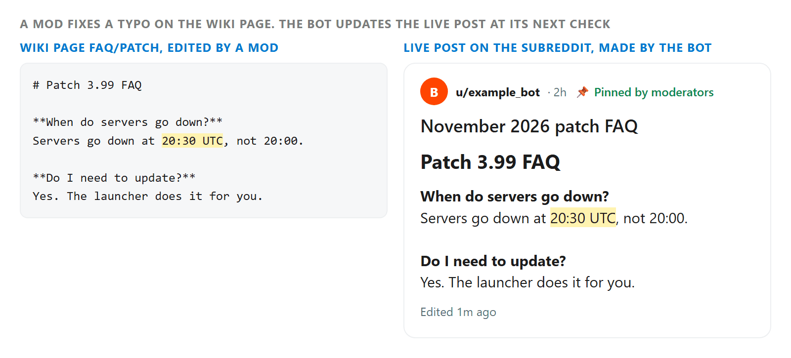

# scheduledpostbot

Makes posts on r/pathofexile from a schedule that mods keep in a wiki page. A mod edits the wiki page, and the bot does the posting, so adding or changing a post never involves code.

The bot is the author of every post it makes. Reddit only lets a post's author edit it, so whenever a mod edits the schedule or the wiki page a post's text comes from, the bot updates the live post to match. That's how several mods can fix a pinned post within minutes of each other.



Redrawn to look like Reddit.

## The schedule

The schedule is one wiki page, named in `config.json`. It holds one YAML entry per post, separated by `---`:

```
title: "{{date %B %Y}} patch FAQ"
post_time: "November 6, 2026 20:30 UTC"
text_from_wiki: "faq/patch"
sticky: 1
---
title: "Maintenance tonight"
post_time: "November 7, 2026 23:00 UTC"
text: "Servers will be down for about an hour."
```

Every entry needs a `title`, a `post_time` with a timezone, and either `text` or `text_from_wiki`, which is the name of another wiki page to use as the post body.

Optional fields:

- `sticky`: `1` for the top slot, `2` or `true` for the bottom slot.
- `distinguish`: defaults to true when the bot account is a mod.
- `update`: set to `false` to skip an entry.
- `sandbox`: another subreddit to post in instead, for testing.

`{{date FORMAT}}` in a title or text becomes today's date, where FORMAT is a Python strftime string. `{{date+7 FORMAT}}` and `{{date-7 FORMAT}}` shift it by that many days.

## Running it

You need Docker and a Reddit script app. The bot account has to be a mod of the subreddit so it can sticky and distinguish, and its refresh token needs the wiki, submit, edit, history and mod post scopes.

Copy `config_example.json` to `instance/config.json` and fill in:

- `auth`: the app's client id and secret, the refresh token, and a user agent.
- `sub_name`: the subreddit to post in.
- `wiki`: the name of the schedule wiki page.
- `pull_delay`: minutes between checks of the wiki. The default is 5.

Build the image:

```
docker build -t scheduledpostbot:latest .
```

Store the config as a secret:

```
cat instance/config.json | docker secret create scheduledpostconfig.json -
```

Start the service:

```
docker service create --name scheduledposttest --secret scheduledpostconfig.json -e CONFIG_FILE='/run/secrets/scheduledpostconfig.json' scheduledpostbot:latest
```
